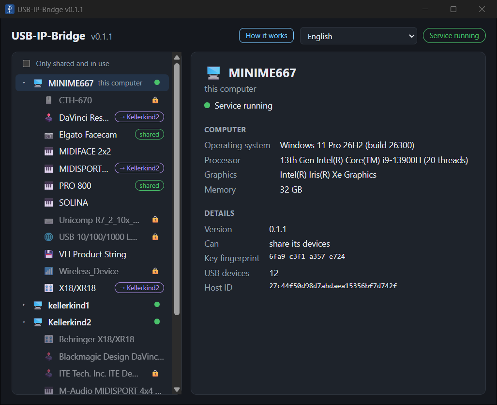

# USB-IP-Bridge

Use USB devices of another computer over the network as if they were plugged in locally.

*[Deutsch](README.de.md)*

Your audio interface hangs on the Windows PC, but you want to record on the Linux PC? With
USB-IP-Bridge the Linux PC takes it over the network, and gives it back when you are done.
It works with audio and MIDI interfaces, cameras, drawing tablets, synthesizers, drives and
most other USB devices.

- Runs as a background service on every computer; computers in the local network find each other.
- A simple app: share a device, give it to another computer, take it back.
- Paired computers only: computers are paired once with a 6-digit code; the connection
  between them is encrypted.
- Built on USB/IP: the Linux kernel's own driver handles the device on the receiving side.

<p align="center"></p>

> **Status: v0.1.1, the first public version.** It is used daily with a Behringer XR18
> (18×18 audio, full duplex, ~26 ms round trip over wired Ethernet) and tested with MIDI
> interfaces, a webcam, a drawing tablet, a synthesizer and USB sticks. Expect rough edges.

## What works where

| Platform | Share its devices | Use devices of others |
|----------|-------------------|-----------------------|
| Windows 10 / 11, x64 (tested on 11) | ✅ | planned |
| Linux x64 with systemd (tested on Ubuntu 24.04) | planned | ✅ |
| macOS, Android | later | later |

## Install

Download the installer from the [releases](https://github.com/Helge666/USB-IP-Bridge/releases).

**Windows:** run `USB-IP-Bridge_0.1.1_x64-setup.exe`. It installs the app, the background
service and firewall rules for private networks. For its USB drivers it also installs
[usbipd-win](https://github.com/dorssel/usbipd-win), unless it is already there.

**Linux (Debian, Ubuntu and derivatives):**

```bash
sudo apt install ./USB-IP-Bridge_0.1.1_amd64.deb
```

This installs the app (menu entry "USB-IP-Bridge"), the service and the virtual USB host controller.

## First steps

1. Install USB-IP-Bridge on every computer that should share or use devices.
2. Open the app. The other computers appear on the left (in the same local network;
   others can be added by name or address).
3. **Pair** the computers once: select the other computer, choose *Pair…* and type the code
   shown on this computer into the app on the other computer.
4. On Windows, select a device and choose *Give to …* (or *Share*). On Linux, select a shared
   device of the other computer and choose *Use here*. *Give back* / *Take back* returns it.

For programs that need a device only while they run, the command line can bring it and give
it back afterwards:

```bash
usbipb run --device 1397:00d4 -- my-daw
```

## Good to know

- A USB device can only be used by one computer at a time. While another computer uses it,
  it is gone on its own computer.
- The network matters: audio interfaces and cameras want a wired connection (Gigabit
  recommended); Wi-Fi works for MIDI, tablets and the like.
- Programs that keep a device open (for example a vendor's control panel) prevent sharing it;
  the app offers to close them and starts them again when the device is back.
- Keyboards, mice, network adapters and Bluetooth adapters are locked automatically, so they are
  not given away by accident. Right-click a device to lock or unlock it.
- Windows: the network has to be set to *private* (Settings → Network → Properties); in a
  *public* network the computers do not find each other.
- Only pair computers that belong to you.
- The data on the USB/IP connection itself is not encrypted (only paired computers are
  accepted); use it in your own network, or over a VPN between networks.

## Command line

`usbipb list | status | attach [N] | detach [N] | share/unshare VID:PID | pair COMPUTER |
pair-answer ID CODE | unpair COMPUTER | run [--device D] -- PROGRAM`

Configuration (optional): `C:\ProgramData\USB-IP-Bridge\config.toml` on Windows,
`/etc/usb-ip-bridge/config.toml` on Linux; see [packaging/examples](packaging/examples).

## Uninstall

Windows: *Settings → Apps → USB-IP-Bridge → Uninstall* (also removes usbipd-win if it came
with USB-IP-Bridge). Linux: `sudo apt remove usb-ip-bridge` (`purge` also removes the key and
the list of paired computers).

## Build from source

Rust (stable), Node.js (Windows, for the Tauri CLI) or `cargo install tauri-cli` (Linux), and
on Linux the WebKitGTK development files (`libwebkit2gtk-4.1-dev`).

```bash
cd gui
npx tauri build      # Windows: setup program in target/release/bundle/nsis
cargo tauri build    # Linux: .deb in target/release/bundle/deb
```

## Documentation

- [CHANGELOG.md](CHANGELOG.md)
- [PLAN.md](PLAN.md) – design and roadmap (German)
- [THIRD-PARTY.md](THIRD-PARTY.md) – components and their licenses

## License

[GPL-3.0-or-later](LICENSE)
